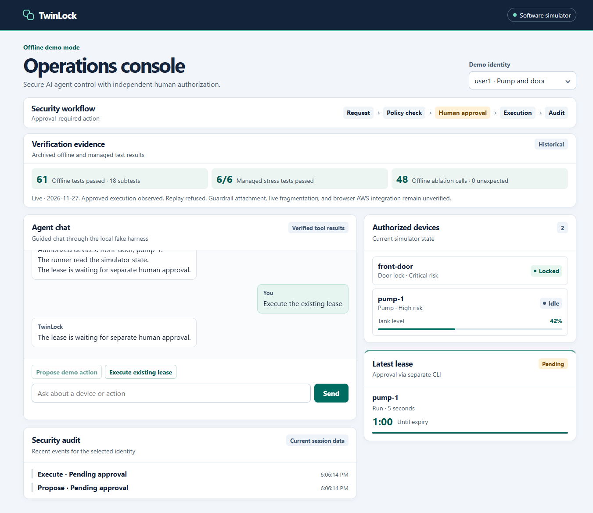
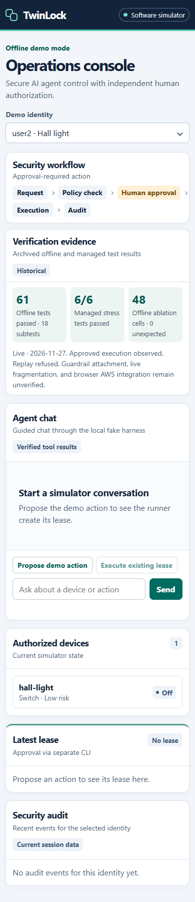
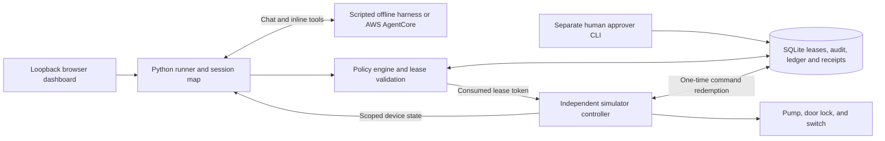

# TwinLock

Secure AI agent control with independent human authorization.

TwinLock lets an agent request one bounded action on a registered software-simulated device. A language model can understand a request, but the device owner, fresh state, action limits, and human consent have to be checked outside the model.

## What makes TwinLock different

TwinLock gives the agent four narrow tools and uses single-use, expiring leases for execution. A separate approver CLI handles human consent where policy requires it. The controller independently checks the command and applies hard limits. The browser puts the current device, lease, and audit state side by side with separately labeled historical evidence.

## Screenshots

**Desktop** · An unapproved pump request stays pending while the simulator remains idle.



**Mobile** · The second demo identity sees its own hall light.



## Architecture



**Stack.** Python 3.10+ with SQLite JSON support, a standard-library loopback HTTP server, and buildless HTML, CSS, and JavaScript. Pytest runs the offline suite. The optional live adapter uses boto3 with AgentCore `InvokeHarness` support.

### Security enforcement layers

| Layer | What it checks |
|---|---|
| Tool boundary | The runner accepts four known tools, validates their argument schema, and binds identity server-side. The inspected managed allowlist also excluded shell and file tools. |
| Policy and consent | The backend scopes ownership, validates action bounds, and checks state and budget. The separate CLI records consent when required. |
| Lease and replay | Execution rechecks policy and the original expiry. A conditional SQLite update consumes the lease once. The controller validates the bound command and records a unique receipt. |
| Simulator safeguards | The controller enforces independent duration caps, pump level and heartbeat rules, and timed door relock. |

[Full rules](docs/RULES.md) · [Rule-to-code mapping](docs/ENFORCEMENT.md)

## Verified results

| Verification | Observed result |
|---|---|
| Offline pytest | **61 passed** and **18 subtests passed**. [Saved summary](docs/evidence/offline-pytest.json) |
| Offline ablation | **48 matrix cells**, zero unexpected outcomes across 12 cases and four configurations. [Ablation report](docs/ABLATION.md) |
| Managed AWS stress, November 27, 2026 | **6 of 6 passed**, covering injection, authorization, pending approval, expiry, replay, and tool restriction. [Case evidence](docs/STRESS_TEST.md#observed-results) |
| Managed AWS smoke, November 27, 2026 | One human-approved execution, one matching ledger row, one controller receipt, and an audited replay refusal. [Sanitized report](docs/evidence/live-integration.json) |

Reproduce the offline results from the repository root in PowerShell:

```powershell
python -m pip install pytest
python -m pytest -q -p no:cacheprovider
python -m attacks.run_ablation --mock
```

## Run locally

With Python installed, run from the repository root in PowerShell. The browser demo uses the standard library and needs no package installation or AWS credentials in offline mode.

```powershell
python -m backend.demo_web --offline --db twinlock-demo.db
```

Open [http://127.0.0.1:8765/](http://127.0.0.1:8765/). The server binds to IPv4 loopback. For a repeatable first run, use a fresh local database filename and use that same filename for approval.

### Demo walkthrough

1. Select `user1` and click **Propose demo action**. The pump lease becomes pending and shows the remaining time.
2. Click **Execute existing lease** before approval. The pump stays idle and the audit records the pending approval outcome.
3. While time remains, review the pending lease in a second PowerShell terminal from the same repository root. Run the approval command only if you choose to authorize the displayed action.

   ```powershell
   python -m approver.approve --user user1 --db twinlock-demo.db list
   $twLease = Read-Host 'Paste the lease ID to approve'
   python -m approver.approve --user user1 --db twinlock-demo.db approve $twLease
   ```

4. Back in the browser, click **Execute existing lease** again. Watch the simulated run and audit update. Repeat the request to see replay refused.
5. Switch to `user2` to see only `hall-light`. The historical evidence stays the same across both identities.

For a separately authorized session against an existing deployment, install a compatible boto3 version and configure the AWS profile and `TWINLOCK_HARNESS_ARN` locally. Stop the offline server first.

```powershell
python -m pip install --upgrade boto3
python -m backend.demo_web --live --db twinlock-demo-live.db
```

Use the live database filename for the separate CLI. [Managed verification runbook](docs/STRESS_TEST.md#live-verification)

## Limitations

- All devices are software simulators. The system has no physical hardware integration or hardware-safety validation.
- The local operator chooses between two trusted demo identities. The app is a loopback demo without production authentication or public hosting.
- Offline chat is guided. The browser shows verified tool outcomes and scoped records. A consumed lease and receipt must be interpreted alongside the audit and simulator state.
- The managed inspection found no Bedrock Guardrail reference. Guardrail attachment and intervention, live stream fragmentation, and the browser's live AWS integration remain unverified.

[Technical write-up](docs/PROJECT_WRITEUP.md) · [90-second demo script](docs/DEMO_SCRIPT.md) · [Publication checklist](docs/PUBLICATION_CHECKLIST.md)

## License

TwinLock is released under the [MIT License](LICENSE).
