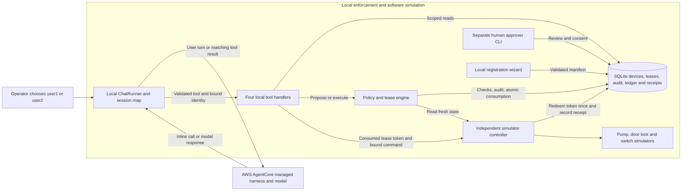

# TwinLock enforcement

The model proposes tool calls. The runner validates names and arguments before dispatch and derives identity from the session map. The managed adapter sends the same session ID with each result. The approver CLI and registration wizard are separate local entry points. [Runner](../backend/runner.py) · [AgentCore adapter](../backend/harness_client.py)

| Rule | Enforcement and evidence |
|---|---|
| P1 | The local dispatcher accepts the four named handlers. Registration runs through the wizard and database manifest validation. The fake harness test verifies that an unknown tool cannot reach a handler. [Tools](../backend/tools.py) · [Wizard](../wizard/add_device.py) · [Runner tests](../tests/test_harness_runner.py) |
| P2 | Approval is a conditional transition in the trusted approver API. The CLI scopes it to the selected owner and uses the original expiry. A pending execution returns `pending_approval`. [Approver API](../backend/approver_api.py) · [Integration test](../tests/test_approval_integration.py) |
| P3 | The local session map binds the operator-selected identity. The runner validates exact schemas and rejects nested `user_id`. Device and lease lookups are tenant scoped. [Runner](../backend/runner.py) · [Local dispatcher](../backend/runner_mock.py) · [Tenancy tests](../tests/test_tenancy.py) |
| P4 / P5 | The manifest validator enforces risk floors, mandatory approval and TTL ceilings. Runtime action checks enforce the registered bounds, while the controller keeps its own duration cap. [Manifest validator](../wizard/validator.py) · [Policy](../backend/policy.py) · [Configuration](../backend/config.py) |
| P6 | The engine reads the bound action and parameters and consumes the lease in SQLite with an owner, prior status, and expiry predicate. The controller redeems the consumed token once against the same device, action and parameters. A unique receipt prevents another redemption. [Lease store](../backend/lease.py) · [Lease tests](../tests/test_lease.py) |
| P7 / P9 | Proposal and execution check policy and required telemetry. Execution checks the bound state version and precondition evidence, then checks the budget and TTL before consumption. [Engine](../backend/engine.py) · [Policy](../backend/policy.py) · [Policy tests](../tests/test_policy.py) |
| P8 | The device listing exposes ID, type, and risk. The runner's allowlist and separate approval path govern what a proposed tool call can do. The system prompt directs the model to treat text as data. [Tool handlers](../backend/tools.py) · [System prompt](SYSTEM_PROMPT.md) · [Offline results](STRESS_TEST.md#observed-results) |
| P10 | The controller verifies the token, then checks controller-specific limits and interlocks. A ledger row records backend consumption. A controller receipt records token redemption, which can precede a controller refusal. Check controller outcomes and simulator state when interpreting the records. [Controller](../simulator/controller.py) · [Controller tests](../tests/test_controller.py) |

## Managed verification

The November 27 run passed injection, authorization, pending approval, expiry, replay, and tool restriction. The deployed inventory matched the four named inline tools and selectors, which exclude managed shell and file tools. The injection case had no inline calls or unauthorized effects. The inspection returned `GuardrailReferencePresent: false`. Guardrail attachment and intervention and live stream fragmentation remain unverified. [Live evidence and configuration inspection](STRESS_TEST.md#observed-results)

## Limitations

- The CLI identities are trusted demo selections. The SQLite file, operator and approver are part of the local trust boundary. The demo has no account login flow or tamper-evident audit storage.
- A command can consume a lease and then be rejected by the controller. TwinLock refuses reuse and does not automatically retry a consumed lease. The live smoke evidence combines the audited successful execution, ledger, and controller receipt. [Live evidence](evidence/live-integration.json)
- The verified managed tool inventory governs model tool selection. The runner's dispatcher separately governs local inline execution. IAM controls service API access and was outside the stress test. [Managed verification](STRESS_TEST.md#live-verification)
- Hardware control, deployment reliability at scale, and recovery across a process or database failure are outside the simulator demonstration.
